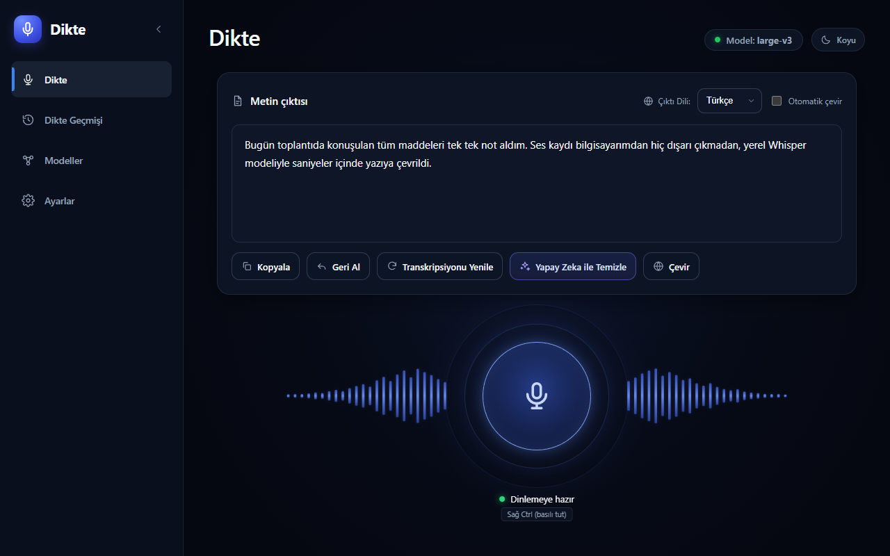
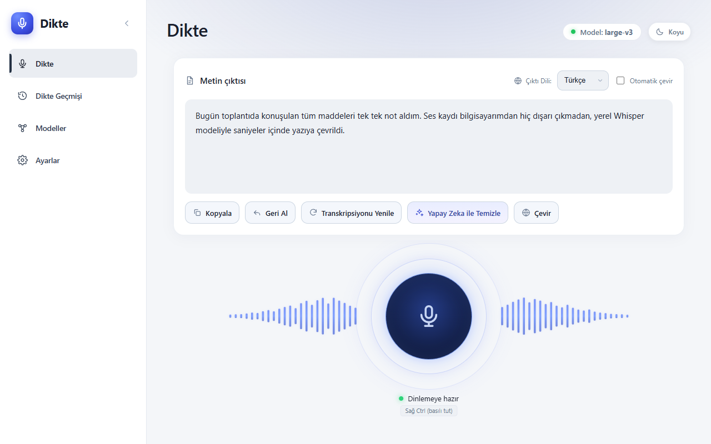

# Dikte

[](https://github.com/mete2012seker-lgtm/dikte/releases/tag/v1.6.1)
[](https://github.com/mete2012seker-lgtm/dikte/releases/latest)
[](LICENSE)

**Windows için ücretsiz, açık kaynak ve tamamen yerel Türkçe sesli dikte uygulaması.**  
Seçtiğin kısayola (varsayılan **Sağ Ctrl**) basılı tutup konuş; bıraktığında sesin bilgisayarından dışarı çıkmadan yerel **Whisper** modeliyle yazıya çevrilir ve etkin pencereye otomatik yapıştırılır.

- **[Windows için İndir (Dikte-Setup-1.6.1.exe — 170 MB)](https://github.com/mete2012seker-lgtm/dikte/releases/download/v1.6.1/Dikte-Setup-1.6.1.exe)**
- **[Tanıtım ve İndirme Sayfası](https://mete2012seker-lgtm.github.io/dikte/)**
- **[Tüm Sürümler (GitHub Releases)](https://github.com/mete2012seker-lgtm/dikte/releases)**



---

## Neden Dikte?

- **Ücretsiz ve açık kaynak (MIT):** Abonelik yok, kullanım sınırı yok.
- **Tamamen yerel ve gizli:** Ses kaydı çeviriden hemen sonra silinir, konuşma metnin log dosyasına yazılmaz, hiçbir bulut sunucusuna gönderilmez.
- **Türkçe odaklı:** Türkçe imla/noktalama ipucu ve Silero VAD (sessizlik filtresi) ile hazır gelir; isteğe bağlı olarak yerel GGUF modeli veya kendi OpenRouter anahtarınla metni temizleyip **Türkçe / İngilizce / Almanca** çıktıya çevirebilirsin.

## Öne Çıkan Özellikler

- **Global bas-konuş kısayolu:** 1, 2 veya 3 tuşlu serbest kısayol (`Sağ Ctrl`, `Ctrl+Shift+D`, `Alt+Space` vb.). Pencere sistem tepsisine küçültülmüşken bile her uygulamada (Word, tarayıcı, WhatsApp, Not Defteri) çalışır.
- **GPU ve CPU desteği:** NVIDIA ekran kartında CUDA (`float16`) ile saniyeler içinde çeviri; ekran kartı yoksa otomatik CPU (`int8`) moduna geçer.
- **Uygulama içi model yöneticisi:** 6 yerleşik Whisper ses modeli (`tiny` → `large-v3`), 4 yerel metin modeli (`Qwen3`, `Gemma 3`, `Llama 3.2`) ve özel Hugging Face modeli ekleme desteği.
- **Sade Dikte.AI ve Klasik tasarım + Açık / Koyu tema:** Ayarlardan görünümü ve temayı anında değiştirebilirsin.
- **Otomatik güncelleme ve geri alma (rollback):** Yeni sürümleri SHA-256 doğrulamasıyla kurar, istersen önceki sürümlere tek tıkla dönebilirsin.
- **Gömülü hata tespit aracı:** Hata oluşursa tek tıkla gizlilik maskeli tanılama raporu kopyalayıp sorun bildirebilirsin.

<details>
<summary>Daha fazla ekran görüntüsü (Açık tema ve Modeller sayfası)</summary>




</details>

---

## Kurulum ve Güvenlik Doğrulaması

1. [Dikte-Setup-1.6.1.exe](https://github.com/mete2012seker-lgtm/dikte/releases/download/v1.6.1/Dikte-Setup-1.6.1.exe) dosyasını indirip çalıştır.
2. Kurulum `C:\Program Files\Dikte` klasörüne yapılır (yönetici izni ister). Kullanıcı verileri (ayarlar, geçmiş, indirilen modeller, günlükler) `%LOCALAPPDATA%\Dikte` altında saklanır.
3. İlk açılışta 5 adımlı karşılama sihirbazı ses modelini ve kısayolunu seçmene yardım eder.

### Windows SmartScreen ("Kişisel bilgisayarınızı korudu") uyarısı hakkında

Dikte bağımsız bir açık kaynak projedir ve kurucu dosya henüz ücretli bir kod imzalama sertifikasıyla imzalanmamıştır. Bu nedenle Windows ilk kurulumda mavi SmartScreen uyarısı gösterebilir.

- Devam etmek için uyarı ekranında **Ek bilgi** → **Yine de çalıştır** seçeneğini kullanabilirsin.
- İndirdiğin dosyanın resmi sürümle birebir aynı olduğunu doğrulamak için PowerShell'de şu komutu çalıştır:

```powershell
Get-FileHash .\Dikte-Setup-1.6.1.exe -Algorithm SHA256
```

Beklenen **v1.6.1** SHA-256 özeti:
```text
953e4f5c0f3599a09c8880efd546334e17a9535883938c0bf59967efe55f3dfd
```

---

## Sorun Giderme ve Hata Bildirimi

Bir hata yaşarsan:
1. Uygulamada **Ayarlar → Sorun Giderme ve Tanılama** bölümünden veya sistem tepsisi menüsünden **"Tanılama Raporu Kopyala"** düğmesine tıkla.
2. Rapor konuşma geçmişini, ses dosyasını ve API anahtarlarını **kesinlikle içermez**; yalnızca teknik günlükleri maskeli biçimde kopyalar.
3. Kopyalanan raporu [GitHub Issues](https://github.com/mete2012seker-lgtm/dikte/issues) sayfasında yeni bir kayıt açarak paylaş.

---

## Kaldırma

Uygulama içinden **Ayarlar → Uygulamayı Kaldır** yolunu kullanabilirsin. İki aşamalı onay ister; **"Modelleri koru"** seçeneği varsayılan olarak işaretlidir (büyük model dosyalarını tekrar indirmemek için). Ayarlar, geçmiş, günlükler ve otomatik başlatma kaydı kaldırılır.

---

## Geliştiriciler İçin

```powershell
# Uygulamayı kaynaktan çalıştır
.venv\Scripts\python.exe -m dikte

# Test süitini çalıştır
.venv\Scripts\python.exe -m pytest -q

# Motor selftest (sentetik Türkçe ses ile)
.venv\Scripts\python.exe -m dikte --selftest --cpu

# PyInstaller + Inno Setup kurucusunu derle
powershell -ExecutionPolicy Bypass -File build.ps1
```

- Sürüm tek kaynaktan (`dikte/config.py` → `APP_VERSION`) okunur.
- Otomatik güncelleme `installer/latest.json` dosyasını (`releases/latest/download/latest.json`) kullanır.
- `web/` klasörü Next.js + Magic UI denemesidir; üretim arayüzü `dikte/ui/` altındadır.
- Ses ve metin modelleri uygulama içinden indirilir; depoya dahil değildir.

## Lisans

[MIT Lisansı](LICENSE) ile yayımlanmıştır.
