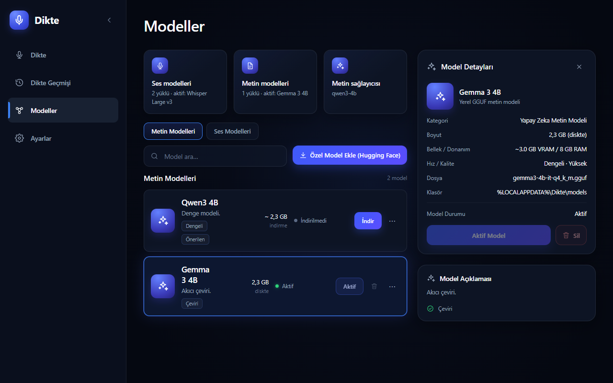
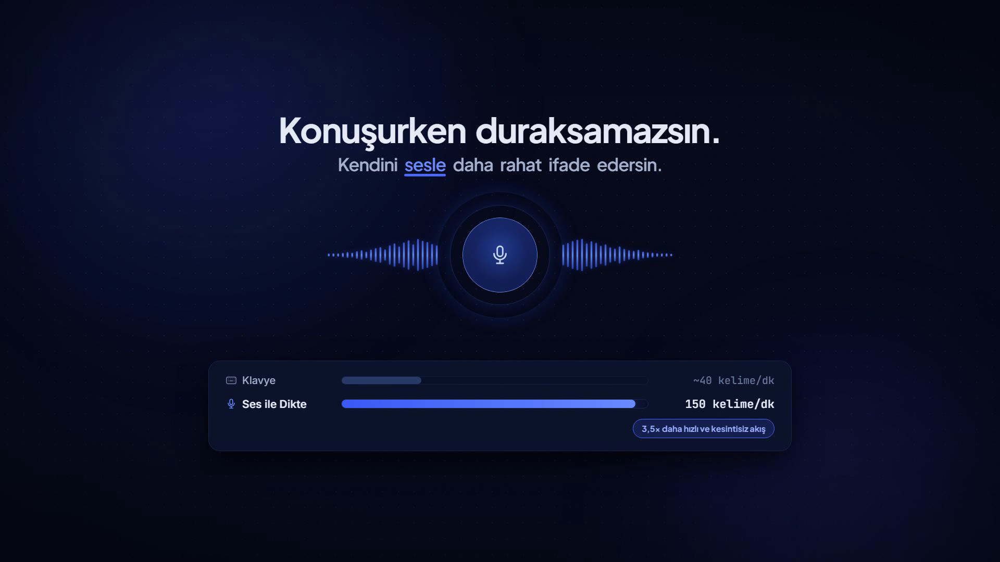

# Dikte

**Language:** **English** | [Türkçe](README.tr.md)

[](https://github.com/mete2012seker-lgtm/dikte/releases/tag/v1.6.1)
[](https://github.com/mete2012seker-lgtm/dikte/releases/latest)
[](LICENSE)

**Free, open-source, and fully local voice dictation app for Windows.**  
Hold down your chosen shortcut (default: **Right Ctrl**) and speak; when you release it, your speech is transcribed locally via **Whisper** without ever leaving your PC and automatically pasted into the active window.

- **[Download for Windows (Dikte-Setup-1.6.1.exe — 170 MB)](https://github.com/mete2012seker-lgtm/dikte/releases/download/v1.6.1/Dikte-Setup-1.6.1.exe)**
- **[Website & Showcase](https://mete2012seker-lgtm.github.io/dikte/)**
- **[All Releases (GitHub Releases)](https://github.com/mete2012seker-lgtm/dikte/releases)**


---

## Why Dikte?

- **Free and open-source (MIT):** No subscriptions, no usage limits.
- **Completely local and private:** Audio recordings are deleted immediately after transcription, your dictated text is never written to logs, and nothing is sent to cloud servers.
- **Smart transcription & optional AI cleanup:** Ships ready with Silero VAD (voice activity detection) and punctuation prompts; optionally clean up filler words or translate your speech into **English / Turkish / German** using a local GGUF model or your own OpenRouter API key.

## Key Features

- **Global push-to-talk shortcut:** Customizable 1, 2, or 3-key combinations (`Right Ctrl`, `Ctrl+Shift+D`, `Alt+Space`, etc.). Works across all apps (Word, browser, WhatsApp, Notepad) even when minimized to the system tray.
- **GPU and CPU support:** Fast CUDA (`float16`) inference on NVIDIA GPUs, with automatic fallback to CPU (`int8`) when no GPU is available.
- **Built-in model manager:** 6 built-in Whisper speech models (`tiny` → `large-v3`), 4 local text models (`Qwen3`, `Gemma 3`, `Llama 3.2`), plus support for adding custom Hugging Face models.
- **Minimal Dikte.AI & Classic UI + Light / Dark themes:** Switch layout style and theme instantly from Settings.
- **Auto-update and rollback:** Verifies new releases with SHA-256 checksums and lets you roll back to previous versions in one click.
- **Built-in diagnostics tool:** Copy a privacy-masked diagnostic report in one click to troubleshoot or report issues safely.

<details>
<summary>More screenshots (Light theme & Models page)</summary>




</details>

---

## Installation & Security Verification

1. Download and run [Dikte-Setup-1.6.1.exe](https://github.com/mete2012seker-lgtm/dikte/releases/download/v1.6.1/Dikte-Setup-1.6.1.exe).
2. Installs to `C:\Program Files\Dikte` (requires administrator privileges). User data (settings, history, downloaded models, logs) is stored under `%LOCALAPPDATA%\Dikte`.
3. On first launch, a 5-step welcome wizard helps you pick your speech model and push-to-talk shortcut.

### About the Windows SmartScreen ("Windows protected your PC") warning

Dikte is an independent open-source project and the installer is not yet signed with a paid code-signing certificate. Because of this, Windows may display a blue SmartScreen prompt on first run.

- To proceed, click **More info** → **Run anyway**.
- To verify that your downloaded installer matches the official release bit-for-bit, run this command in PowerShell:

```powershell
Get-FileHash .\Dikte-Setup-1.6.1.exe -Algorithm SHA256
```

Expected **v1.6.1** SHA-256 checksum:
```text
953e4f5c0f3599a09c8880efd546334e17a9535883938c0bf59967efe55f3dfd
```

---

## Troubleshooting & Bug Reports

If you run into an issue:
1. Open **Settings → Troubleshooting & Diagnostics** inside the app (or right-click the system tray icon) and click **"Copy Diagnostic Report"**.
2. The report **never includes** your dictation history, audio files, or API keys—only sanitized technical logs.
3. Paste the report into a new issue on [GitHub Issues](https://github.com/mete2012seker-lgtm/dikte/issues).

---

## Uninstalling

Go to **Settings → Uninstall App** inside Dikte (or use Windows Installed Apps). It asks for two-step confirmation and keeps **"Keep models"** checked by default so you don't have to re-download large model files. Settings, history, logs, and auto-start entries are cleanly removed.

---

## For Developers

```powershell
# Run the app from source
.venv\Scripts\python.exe -m dikte

# Run the test suite
.venv\Scripts\python.exe -m pytest -q

# Engine self-test (with synthetic test audio)
.venv\Scripts\python.exe -m dikte --selftest --cpu

# Build PyInstaller + Inno Setup installer
powershell -ExecutionPolicy Bypass -File build.ps1
```

- Version is read from a single source of truth (`dikte/config.py` → `APP_VERSION`).
- Auto-update checks `installer/latest.json` (`releases/latest/download/latest.json`).
- `web/` is a Next.js + Magic UI prototype; the production desktop UI lives in `dikte/ui/`.
- `video/` contains the Remotion promo video source project.
- Speech and text models are downloaded inside the app and are not committed to the repository.

---

## Promo Video

A 45-second showcase highlighting voice dictation speed over typing, local Whisper push-to-talk flow, AI cleanup/translation, and Magic UI theme transitions:

[](https://mete2012seker-lgtm.github.io/dikte/#tanitim-videosu)

- **[Watch the Promo Video on the Website (45s, with audio)](https://mete2012seker-lgtm.github.io/dikte/#tanitim-videosu)**
- **[Open / Download MP4 Directly](https://mete2012seker-lgtm.github.io/dikte/assets/dikte-tanitim.mp4)**

---

## License

Released under the [MIT License](LICENSE).
